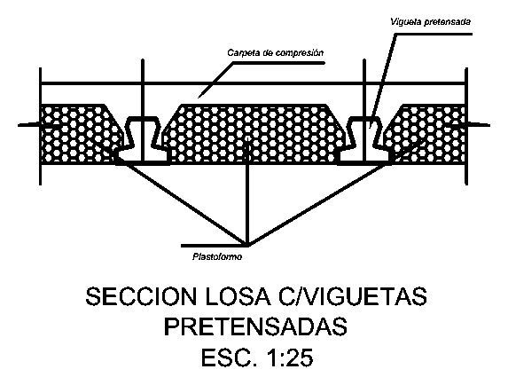
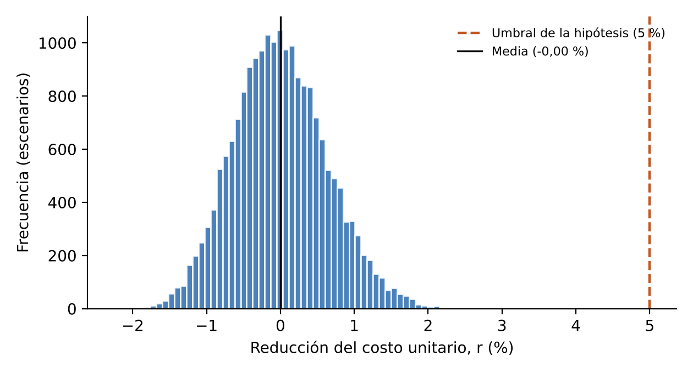
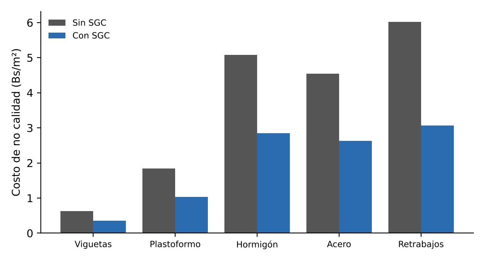
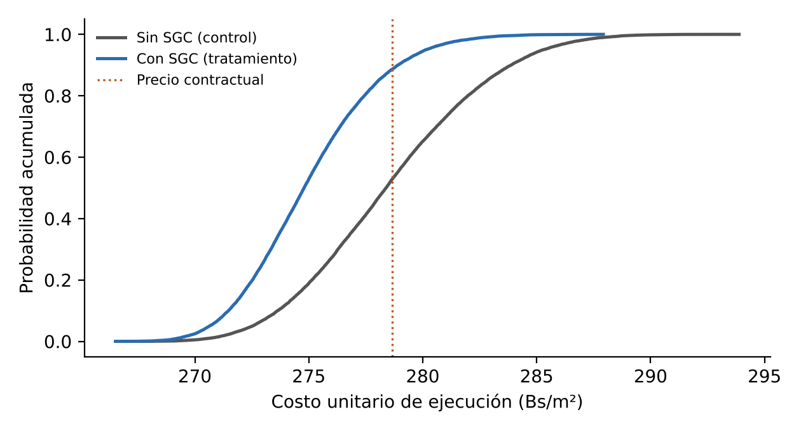

# La tesis explicada en lenguaje sencillo

**Un sistema de calidad para construir mejor, y con menos desperdicio, las losas del Edificio de Posgrado de la UATF (Potosí)**

- **Título de la tesis:** Diseño de un sistema de gestión de la calidad basado en la norma ISO 9001 para reducir costos mediante el control de materiales en losas alivianadas con viguetas pretensadas del Edificio de Posgrado de la Universidad Autónoma Tomás Frías, Potosí.
- **Carrera:** Ingeniería Civil, Universidad Autónoma Tomás Frías (UATF). Seminario de Grado II (CIV 400), modalidad tesis.
- **Postulante:** [Pendiente: nombre del postulante]
- **Tutor:** [Pendiente: nombre del tutor]
- **Versión:** borrador de octubre de 2026.

> **Cómo leer este documento.** Es un resumen de la tesis para personas que no son ingenieras: familias, autoridades y estudiantes. Usa oraciones cortas y explica cada término técnico la primera vez que aparece. Al final hay un glosario y preguntas frecuentes. Todas las cifras vienen de la tesis y de su modelo de costos; cuando una cifra se redondea, se dice «aproximadamente». Lo que el postulante todavía debe completar aparece entre corchetes, así: [Pendiente: …].

## 1. La tesis en un minuto

La Universidad Autónoma Tomás Frías construía su Edificio de Posgrado en Potosí. Se hizo la primera de tres losas, pero la crisis de combustibles paralizó la obra y el contrato se cerró. Los documentos de esa losa muestran que se trabajó sin un sistema de control de la calidad: no hay pruebas del hormigón de la losa, nadie anotó cuánto material se usó y algunas cantidades de acero no cuadran entre documentos. La tesis diseña ese sistema para las dos losas que faltan y calcula su efecto con una simulación por computadora. Resultado: el costo baja aproximadamente 1,5 % en promedio y hay ahorro en 94 de cada 100 escenarios, pero no se alcanza la meta del 5 %. Aun así, el desperdicio y el costo de hacer mal las cosas bajan casi a la mitad. Por eso se recomienda aplicarlo.

## 2. ¿Qué se construía y qué pasó?

### El edificio

El Edificio de Posgrado de la UATF se levanta en la Ciudadela Universitaria, sobre la avenida Las Banderas de Potosí, a 3.650 metros sobre el nivel del mar. El proyecto completo tiene seis niveles, con auditorios, aulas, laboratorios y biblioteca para los programas de posgrado.

La parte contratada en 2025 era solo la **obra gruesa**, es decir, el «esqueleto» de hormigón armado (cimientos, columnas, vigas y losas) hasta la tercera losa. El contrato se firmó el 24 de abril de 2025 por Bs 3.367.031,95 y un plazo de 270 días. Con una modificación llegó a Bs 3.610.125,43 (7,22 % más) y a 360 días.

### La losa: un sándwich de tres capas

Una **losa** es la placa de hormigón que hace de techo de un nivel y de piso del siguiente. Este edificio usa **losas alivianadas**: son más livianas que una losa maciza porque parte de su volumen se rellena con un material ligero. Funcionan como un sándwich (Figura 1):

- **La base: las viguetas pretensadas.** Son barras largas de hormigón hechas en fábrica, con alambres de acero muy estirados por dentro que les dan fuerza. Se colocan en paralelo, cada 50 cm, y son las que cargan el peso.
- **El relleno: los bloques de plastoformo.** Es el mismo material blanco y liviano de las cajas de los electrodomésticos (poliestireno expandido). No carga peso: ocupa espacio para que la losa pese menos.
- **La tapa: una capa de hormigón de 5 cm** con una malla de fierro delgado, llamada «carpeta de compresión». Se vacía en la obra y une todo en una sola pieza.

**Figura 1.** Corte de la losa alivianada del edificio

*Fuente:* Plano 02 del proyecto «Construcción Edificio de Posgrado» de la UATF.

**Cómo leerla.** Es la losa cortada como se corta un pan. Las piezas con forma de «T» invertida son las viguetas. Los bloques con puntitos son el plastoformo. La franja de arriba es la carpeta de hormigón, que también rellena los espacios entre los bloques.

La losa es una parte grande de la obra. Su ítem en el contrato representaba el 21,45 % del monto original, con un precio de Bs 215,68 por metro cuadrado (m²). El acero de la losa se paga aparte, en el ítem del acero.

### Lo que alcanzó a construirse

La **primera losa** tiene 41 paños (cada «paño» es un recuadro de losa entre vigas) y suma 1.109,84 m². Se armó en noviembre de 2025. La Supervisión autorizó el vaciado del hormigón el 28 de noviembre, y la losa se incluyó completa, por Bs 239.365,07, en la planilla de pago cerrada el 8 de diciembre de 2025.

### La crisis de combustibles y la paralización

En 2025 faltaron diésel y gasolina en el país. En junio, la fábrica de cemento FANCESA paralizó temporalmente su producción por falta de diésel. El distribuidor del acero avisó a la empresa que, de un pedido de 20 toneladas, solo había entregado el 30 %. En noviembre, en pleno armado de la losa, la empresa anotó que los materiales tardaban mucho en llegar. Los precios también subieron: en Potosí, entre diciembre de 2023 y septiembre de 2026, el cemento subió aproximadamente 74 % y el fierro aproximadamente 66 %, según precios del Instituto Nacional de Estadística (INE) citados en la tesis.

El 5 de enero de 2026, la empresa contratista presentó una carta notariada para resolver el contrato por fuerza mayor. Explicó que el Decreto Supremo 5503 había quitado la subvención a la gasolina y al diésel y que eso encareció los materiales, el transporte y la mano de obra, y pidió paralizar la obra. La UATF respondió favorablemente el 10 de febrero de 2026. El contrato se cerró con un avance del 57,43 %.

### Qué significó para la tesis

El plan original era sencillo: medir la primera losa, hecha sin sistema de calidad; aplicar el sistema en la segunda, y comparar. Pero **la segunda losa no se construyó durante la investigación**. Quedan pendientes 2.234,60 m²: la segunda y la tercera losa, de 1.117,30 m² cada una y casi iguales a la primera. Por eso la tesis aplicó el plan alternativo que su perfil ya preveía: evaluar el sistema con un modelo y una simulación (sección 5).

## 3. ¿Cuál era el problema?

Imagine que manda construir el techo de su casa. Al final, nadie anotó cuántas bolsas de cemento se usaron, nadie probó si el hormigón quedó resistente y los papeles de pago dicen cosas distintas. En pequeño, eso es lo que muestran los documentos de la primera losa. La tesis los revisó página por página: planillas de pago, planos, certificados de los materiales y el **Libro de Órdenes**, que es el cuaderno oficial donde la empresa y la Supervisión se comunican.

### Desperdicio: material que se paga y no queda en la losa

El **desperdicio** es el material que se compra pero no termina dentro de la losa: recortes, roturas, sobrantes o derrames. Estos son los ejemplos documentados:

- **Plastoformo.** Según los planos se necesitaban aproximadamente 2.238 bloques. Se entregaron 2.350, es decir, 112 más: **aproximadamente 5 % más que lo necesario**. Nadie anotó cuántos se colocaron ni cuántos sobraron.
- **Acero de la losa.** Según los planos, la losa necesitaba aproximadamente 3.573 kg. En la planilla de pago figuran 4.171,18 kg: **aproximadamente 17 % más que la cantidad teórica**. La diferencia puede deberse a recortes y empalmes, a fierros que los planos no detallan o a una medición mayor que lo ejecutado; con los documentos disponibles no se puede saber. Es una **inconsistencia documental que deben verificar la Supervisión y la Fiscalización**.
- **Hormigón y viguetas.** No hay ningún registro de cuánto se pidió ni de cuánto se vació. Para estos materiales, la tesis tuvo que usar valores de otras investigaciones.

### Falta de registros: calidad sin pruebas

- **Ninguna probeta de la losa.** Una **probeta** es un cilindro de hormigón fresco que se deja endurecer y luego se rompe en una prensa del laboratorio para comprobar su resistencia. El único certificado de laboratorio tiene 12 probetas: 10 de columnas y 2 de vigas. **Ninguna es de la losa.** Además, se ensayaron a los 55 a 76 días, no a los 28 días que se exigen, y las preparó la propia empresa. El código de referencia (ACI 318-25) pide al menos una muestra por cada 464,5 m² de losa, aproximadamente: en la primera losa correspondían al menos tres.
- **Se pagó antes de poder probar.** El hormigón se evalúa a los 28 días. La losa entró en una planilla de pago cerrada el 8 de diciembre de 2025, antes del 26 de diciembre, que era la primera fecha en que su hormigón podía cumplir esa edad.
- **Cero problemas anotados.** El Libro de Órdenes tiene 24 anotaciones en ese periodo y ninguna registra un defecto, un material rechazado o un trabajo rehecho. Las 8 solicitudes de vaciado se aprobaron el mismo día en que se pidieron. Que no se anoten problemas no prueba que no los hubo: solo muestra que no quedó constancia.
- **Certificados tardíos.** Los certificados de las viguetas y del plastoformo tienen fecha 27 de noviembre de 2025, cuando la losa se armaba al menos desde el 14 de noviembre. Además, no tienen firma.
- **Documentos que no coinciden.** El plano dibuja bloques de plastoformo de 15 cm de alto, pero la especificación técnica y los certificados dicen 20 cm. No se encontró una orden que aclare cuál vale.

### Cantidades que no cuadran

En los documentos de cierre del contrato aparecen más diferencias en el acero:

- En el cómputo de cierre, en su versión en archivo digital, el acero de la losa figura **multiplicado por tres** (3 × 4.171,18 kg), aunque solo se construyó una losa.
- Existen dos versiones de la planilla de cierre, con descuentos de acero distintos (1.862,81 kg en la versión firmada y 1.915,16 kg en la digital), y hay tres cifras diferentes del acero acumulado.

Son **inconsistencias documentales que deben verificar la Supervisión y la Fiscalización**. La tesis no afirma que alguien se haya equivocado. Lo que señala es que estas cantidades se revisaron al cerrar el contrato y no en el mes en que se originaron, cuando era fácil aclararlas.

### El costo de no calidad: pagar dos veces por hacer mal la primera

El **costo de no calidad** es lo que cuesta hacer mal las cosas: el material desperdiciado y el trabajo que hay que rehacer. Es como pagar dos veces por hacer mal la primera: se paga el material perdido y se vuelve a pagar para reponerlo o corregir. Con los valores más probables, la tesis estimó que en la primera losa este costo fue de **Bs 19,60 por m², aproximadamente 7 % del costo por m²** (7,12 %).

### Una foto del conjunto

La tesis comparó la gestión de la obra con los 48 requisitos de la norma ISO 9001 que se aplican a la losa. En conjunto, la obra cumplió **aproximadamente el 20 %** de ellos (19,8 %). También identificó 22 **no conformidades**, es decir, incumplimientos de un requisito. Más de la mitad (12 de 22) estaban en la medición y en la gestión. La causa de fondo no era la mano de obra ni el clima, sino la falta de un sistema que mida, registre y compare.

## 4. ¿Qué es un sistema de gestión de la calidad y qué se diseñó?

### La idea, con dos ejemplos

Antes de despegar, un piloto de avión no confía en su memoria: recorre una **lista de chequeo** y no despega hasta marcar cada punto. Un **sistema de gestión de la calidad (SGC)** es eso, aplicado a una obra: reglas escritas, controles y registros que dicen qué revisar, cuándo, quién lo hace y cómo se deja constancia.

También se parece a una **receta con controles**: «precaliente el horno; verifique que llegue a 180 °C antes de meter la torta; a los 30 minutos, pinche con un palillo y, si sale limpio, retírela». La receta no solo dice qué hacer: dice cómo comprobar que salió bien antes de pasar al paso siguiente.

La norma internacional que describe un buen SGC es la **ISO 9001**. Su edición vigente es la ISO 9001:2026, publicada en septiembre de 2026 y adoptada en Bolivia por IBNORCA. La norma organiza el trabajo en un ciclo que se repite: **planificar, hacer, verificar y actuar** (ciclo PHVA).

### Lo que diseñó la tesis

No es un sistema para certificar a una empresa. Es un plan concreto para construir bien las dos losas que faltan, con el menor desperdicio posible. Tiene siete piezas principales:

1. **Plan de la calidad.** Es el «manual de la losa», preparado con la guía de la norma ISO 10005. Dice qué se controla, con qué criterio, quién responde y qué formularios se llenan. Fija metas medibles; por ejemplo, desperdiciar como máximo el 3 % del hormigón y el 4 % del acero.
2. **Plan de puntos de inspección y ensayo (PPI).** Es la lista de chequeo del piloto: 14 controles, desde que llega el material hasta que se retiran los puntales. Cuatro son **puntos de espera**: el apuntalamiento, el armado, el vaciado y el retiro de los puntales. En esos puntos el trabajo se detiene hasta que la Supervisión revisa y firma.
3. **Control de materiales**, con cinco procedimientos:
   - recibir y revisar cada material **antes** de usarlo, con su certificado;
   - guardarlo bien e identificarlo;
   - entregarlo por paño, con vales, para saber cuánto consume cada paño;
   - **conciliar las cantidades**: comparar cinco números (lo que dicen los planos, lo que llegó, lo que se colocó, lo que se midió con la Supervisión y lo que se paga) y aclarar cualquier diferencia **antes** de cobrar. Es como cuadrar la caja de una tienda cada día, y no una vez al año;
   - separar y marcar el material defectuoso para que nadie lo use por error.
4. **Control del hormigón.** Una mezcla aprobada; la prueba del cono, que mide qué tan aguado está el hormigón fresco; probetas de la losa tomadas al azar y ensayadas a los 28 días; el curado, que consiste en mantener húmedo el hormigón para que gane resistencia, y la protección contra la lluvia y las heladas de Potosí. Cada paño se paga cuando sus ensayos salen conformes.
5. **Registro de problemas y mejora.** Cada problema se anota, se busca su causa y se corrige, para que no se repita en el paño siguiente.
6. **Costos de la calidad.** Se registra cuánto cuesta prevenir y revisar, y cuánto cuestan los errores. Lo que no se mide no se puede mejorar.
7. **Personas y riesgos.** Tres charlas prácticas de 2 horas (sobre el sistema, los materiales y el hormigón) y una lista de 14 riesgos con su respuesta: falta de combustible, alza de precios, lluvias, heladas y otros.

Todo se registra en formularios sencillos, que están listos en los anexos de la tesis.

### ¿Quién lo aplica y quién lo controla?

Lo aplica la empresa que construya las losas que faltan, porque es la que compra, guarda y coloca los materiales. La UATF, por medio de la Supervisión y la Fiscalización, lo exige y verifica que se cumpla. Por eso la tesis recomienda incluirlo en el documento de contratación del saldo de la obra.

## 5. ¿Cómo se evaluó sin construir la segunda losa?

No se puede medir una losa que no existe. La solución fue comparar, en la computadora, dos versiones del futuro.

### Una calculadora del costo por metro cuadrado

La tesis armó un **modelo de costos**: una fórmula que calcula cuánto cuesta cada m² de losa sumando tres partes:

1. lo que costaría hacerla «perfecta», sin ningún desperdicio;
2. el costo de no calidad: el desperdicio de cada material y los trabajos rehechos;
3. el costo del propio sistema de calidad, es decir, prevenir y revisar.

Todo se calcula con los precios del contrato, que no cambian. Así, la subida de precios de 2025 y 2026 no se confunde con el efecto del sistema. El modelo se ajustó para que, sin sistema, el costo promedio coincida con el precio que se pagaba por la losa: Bs 278,65 por m² (Bs 215,68 de la losa más Bs 62,98 de su acero).

### Dos escenarios: sin sistema y con sistema

- **Sin SGC (escenario de control):** las dos losas se construyen como la primera.
- **Con SGC (escenario de tratamiento):** el sistema reduce el desperdicio y los trabajos rehechos en cierto porcentaje, que se llama **eficacia**, pero cuesta dinero: un encargado de calidad a medio tiempo, ensayos, capacitación, control del almacén y formularios.

La diferencia entre los dos escenarios es el efecto del sistema. Es la misma idea de los estudios médicos, donde un grupo recibe el tratamiento y otro no.

### Tirar los dados miles de veces

Muchos datos no se conocen con exactitud. ¿Cuánto hormigón se desperdicia sin control: 5 % o 22 %? ¿Cuánto reduce el sistema: 10 % o 70 %? En lugar de adivinar un solo valor, la tesis tomó rangos de los documentos de la obra y de otras investigaciones, cada uno con un mínimo, un valor más probable y un máximo.

Luego la computadora **«tiró los dados» 20.000 veces**. En cada tirada eligió al azar un valor dentro de cada rango y calculó el costo con sistema y sin él. Así se obtuvieron 20.000 futuros posibles. Contar en cuántos de ellos el sistema ahorra da una **probabilidad**. Este método se llama **simulación de Monte Carlo**, por el famoso casino.

### La regla para decidir, fijada de antemano

La **hipótesis general** decía: «el sistema reduce el costo por m² en al menos 5 %». La regla, fijada antes de calcular, fue exigente: se acepta solo si se cumple en **al menos 95 de cada 100 escenarios** (probabilidad de 0,95 o más). Es la versión con probabilidades de la regla estadística habitual, con un nivel de significancia de 0,05. Con la misma regla se evaluaron dos **hipótesis específicas**: que el sistema reduce el desperdicio (HE1) y que reduce el costo de no calidad (HE2).

La guía del Seminario de Grado acepta este tipo de modelo, llamado «modelación de simulación teórica», siempre que tenga un escenario de control y calcule la incertidumbre. Además, se comprobó que el modelo repite el cálculo hecho a mano, que 20.000 tiradas bastan (el promedio ya no cambia al agregar más) y qué pasa si los datos dudosos son más altos o más bajos.

## 6. ¿Qué se encontró?

La Tabla 1 resume los resultados principales de los 20.000 escenarios.

**Tabla 1.** Cifras clave de la tesis

| Indicador | Sin SGC | Con SGC | En palabras sencillas |
|---|---|---|---|
| Costo por m² (promedio de 20.000 escenarios) | Bs 278,59 | Bs 274,48 | Con el sistema, cada m² cuesta aproximadamente Bs 4 menos. |
| Reducción del costo por m² | — | 1,47 % en promedio | Aproximadamente 1,5 %. En 90 de cada 100 escenarios queda entre −0,05 % y 3,21 %. |
| Probabilidad de que haya ahorro | — | 0,9422 | Hay ahorro en aproximadamente 94 de cada 100 escenarios. |
| Probabilidad de llegar a la meta del 5 % | — | 0,0008 | Solo 8 de cada 10.000 escenarios; la regla pedía 9.500. |
| Desperdicio de materiales (ponderado por su costo) | 8,16 % | 4,70 % | El desperdicio baja casi a la mitad. |
| Costo de no calidad (Bs por m²) | 22,80 | 12,58 | Aproximadamente 45 % menos (44,82 %). |
| Costo del propio sistema (Bs por m²) | — | 6,11 en promedio | Con los valores más probables, Bs 4,86 por m²: aproximadamente Bs 10.900 para todo el saldo. |
| Ahorro esperado en los 2.234,60 m² que faltan | — | Bs 9.177 | Aproximadamente Bs 9.200, ya descontado el costo del sistema. En 90 de cada 100 escenarios va de una pérdida de Bs 328 a un ahorro de Bs 20.328. |
| Eficacia mínima para no perder dinero | — | 24,8 % | El sistema debe evitar al menos una cuarta parte de las pérdidas. |
| Eficacia necesaria para llegar al 5 % | — | 95,1 % | Tendría que evitar casi todas las pérdidas. |
| Reducción con un sistema perfecto (eficacia del 100 %) | — | 5,35 % | Ni con un sistema perfecto habría mucho margen sobre el 5 %. |

*Fuente:* modelo de costos y simulación de Monte Carlo de la tesis. «Promedio» es la media de los 20.000 escenarios; «90 de cada 100» es el rango entre los percentiles 5 y 95; «valores más probables» es el cálculo con el valor más probable de cada dato.

La Tabla 2 muestra la decisión sobre cada hipótesis. H1 es la hipótesis de la investigación y H0, la **hipótesis nula**, que afirma lo contrario.

**Tabla 2.** Decisión sobre las hipótesis

| Hipótesis | Qué afirma | Probabilidad estimada | Decisión (regla: 0,95 o más) |
|---|---|---|---|
| General (HG) | El SGC reduce el costo por m² en 5 % o más | 0,0008 | No se acepta H1 (se mantiene H0) |
| Específica 1 (HE1) | El SGC reduce el desperdicio de materiales | 1,0000 | Se acepta H1 |
| Específica 2 (HE2) | El SGC reduce el costo de no calidad | 1,0000 | Se acepta H1 |

*Fuente:* modelo de costos y simulación de Monte Carlo de la tesis.

Las dos hipótesis específicas se aceptan con una condición: que el sistema se aplique de verdad en la obra. La sección 7 explica qué pasa si no se aplica.

**Figura 2.** ¿Cuánto baja el costo? Resultado de los 20.000 escenarios

*Fuente:* modelo de costos de la tesis.

**Cómo leerla.** Cada barra azul cuenta cuántos escenarios, de los 20.000, dieron una reducción del costo dentro de ese tramo. La escala de abajo va de −2 % a 6 %. La línea negra marca el promedio: 1,47 %. La línea roja discontinua marca la meta del 5 %. Casi todas las barras están a la derecha del cero, es decir, con ahorro. Pero prácticamente ninguna llega a la línea roja: solo 8 de cada 10.000 escenarios alcanzan la meta.

**Figura 3.** ¿Dónde se pierde el dinero? Costo de no calidad por material, sin sistema y con sistema

*Fuente:* modelo de costos de la tesis, con los valores más probables.

**Cómo leerla.** Cada par de barras corresponde a un material o a los trabajos rehechos (retrabajos). La barra gris es el costo de no calidad sin sistema y la azul, con sistema, en bolivianos por m². Todas las barras azules son más bajas: el sistema reduce las pérdidas en todos los rubros. En total, el costo de no calidad baja de Bs 19,60 a Bs 10,81 por m². Las barras más altas son las del acero, los retrabajos y el hormigón: ahí conviene concentrar los controles. Las del plastoformo y las viguetas son pequeñas.

**Figura 4.** Costo por m² con sistema y sin él en los 20.000 escenarios

*Fuente:* modelo de costos de la tesis.

**Cómo leerla.** Cada curva ordena los 20.000 costos simulados, del más barato al más caro. Elija un costo en la escala de abajo y suba hasta la curva: la altura indica qué parte de los escenarios cuesta eso o menos (0,5 es la mitad; 1 son todos). La curva azul (con sistema) está a la izquierda de la gris (sin sistema): con el sistema, la losa tiende a costar menos. La línea punteada es el precio del contrato, Bs 278,65 por m². Sin el sistema, aproximadamente la mitad de los escenarios supera ese precio, porque el modelo se ajustó para que su promedio coincida con él. Con el sistema, la gran mayoría queda por debajo.

**En pocas palabras:** el sistema probablemente ahorra, pero poco (aproximadamente 1,5 %). Reduce casi a la mitad el desperdicio y el costo de no calidad. Y no alcanza la meta del 5 %.

## 7. ¿Por qué no se alcanzó el 5 % y por qué igual vale la pena?

### Por qué no se alcanzó

1. **La meta venía de otra escala.** El 5 % se fijó con estudios que miden los trabajos rehechos en **proyectos enteros**: en promedio, el 6,59 % del costo de un proyecto (Álvarez Quintero, 2014). Aquí se mide **un solo ítem**, la losa, donde hay menos que ahorrar.
2. **No hay tanto que ahorrar.** En la losa, el costo de no calidad es aproximadamente el 7 % del costo por m², y el sistema cuesta aproximadamente el 1,8 %. Aunque se eliminaran todas las pérdidas, algo que ningún sistema logra, la reducción no pasaría de 5,35 %.
3. **Se necesitaría un sistema casi perfecto.** Para llegar al 5 %, el sistema tendría que evitar aproximadamente el 95 % de las pérdidas (95,1 %). Los estudios revisados reportan reducciones de entre 10 % y 89 %.
4. **Lo que más pesa.** El análisis de sensibilidad muestra que el resultado depende sobre todo de cuántos trabajos se rehacen sin sistema y de cuánto cuesta el propio sistema. Ningún dato, llevado por separado a su valor más favorable, alcanza el 5 %. Si además se cuentan los **costos ocultos** de la mala calidad, como las horas perdidas esperando material, la reducción media sube a aproximadamente 3,2 % y la probabilidad de llegar al 5 % llega a aproximadamente 0,13: todavía lejos de 0,95.

> **Una analogía.** Es como querer ahorrar el 5 % del gasto de la casa arreglando solo las goteras. Si el agua que se pierde por las goteras vale el 7 % del gasto y el plomero cobra casi el 2 %, aunque se arreglaran todas las goteras el ahorro sería apenas algo más del 5 %. Y ningún plomero arregla el 100 % de las goteras.

El resultado es honesto: la meta del 5 % se sobreestimó, pero el sentido del efecto se confirma.

### Por qué igual vale la pena

1. **Probablemente ahorra, y se paga solo.** Hay ahorro en aproximadamente 94 de cada 100 escenarios. Después de pagar el sistema, queda un ahorro esperado de aproximadamente Bs 9.200 en las dos losas que faltan.
2. **Reduce el desperdicio y el costo de no calidad casi a la mitad.** Por eso se aceptan las dos hipótesis específicas.
3. **Da beneficios que el modelo no cuenta en bolivianos:**
   - **Seguridad.** Con probetas de cada losa se demuestra que el hormigón tiene la resistencia del diseño.
   - **Pagos correctos.** La conciliación mensual habría dado una alerta inmediata: 3 × 4.171,18 kg para una sola losa equivalen a 11,28 kg de acero por m², el triple de la cantidad de la planilla de pago. La diferencia se habría aclarado en el mes en que apareció, y no al cerrar el contrato.
   - **Datos para el futuro.** La próxima obra tendrá consumos reales y no dependerá de valores de otros estudios.
   - **Orden y transparencia.** Habrá registros firmados que cualquiera puede revisar, algo importante en una obra pagada con recursos públicos.
4. **Con una condición: que se aplique de verdad.** La tesis simuló el riesgo de que el sistema se pague pero no se aplique en obra, con una probabilidad de 15 %. En ese caso, la reducción media baja a 0,90 % y la probabilidad de ahorrar, a aproximadamente 0,80. Si la eficacia del sistema fuera aproximadamente la mitad de la reportada, la probabilidad de ahorrar caería a aproximadamente 0,53; si su costo se duplicara, a aproximadamente 0,27. Por eso se recomienda un **sistema «ligero»**: con el personal que ya existe y concentrado en los controles que más rinden.

## 8. Límites honestos y qué falta

Toda investigación tiene límites. Estos son los de esta tesis:

- **El efecto no se midió en la obra.** Es una estimación *ex ante*, es decir, hecha antes de que ocurra, con un modelo. Deberá comprobarse cuando se construya la segunda losa, comparando paño por paño con la primera. La tesis deja el procedimiento y la prueba estadística para hacerlo (la prueba *t* de Student o la de Wilcoxon).
- **Faltan datos de la primera losa.** Solo el plastoformo y el acero tienen datos documentados. El desperdicio del hormigón y de las viguetas, los trabajos rehechos y la eficacia del sistema vienen de otras investigaciones. [Pendiente: completar la línea base con las notas de entrega, los vales de cemento y los volúmenes vaciados, si la Supervisión o la empresa los facilitan.]
- **El precio de referencia se reconstruyó.** No se contó con el análisis de precios unitarios (APU) del contrato. Se armó uno de referencia y se ajustó al precio del contrato; el factor de ajuste fue 0,962, cercano a 1, lo que indica una reconstrucción razonable. [Pendiente: obtener el APU contractual de la losa por medio de la Fiscalización.]
- **La validación por expertos aún no se hizo.** El formulario para que al menos tres ingenieros califiquen el sistema, con el coeficiente V de Aiken, está listo, pero todavía no se aplicó. [Pendiente: aplicar la validación por juicio de expertos y registrar sus resultados.]
- **El diagnóstico se hizo solo con documentos.** Un requisito sin evidencia escrita se calificó como no cumplido, aunque quizá se cumplió en la práctica. [Pendiente: entrevistar a la Dirección de Obra, la Supervisión y la Fiscalización.]
- **La norma nueva no estaba a mano.** La ISO 9001:2026 es de pago y su texto no estaba disponible; el diseño usa su estructura de capítulos, que se mantiene respecto de la edición de 2015. [Pendiente: adquirir la NB/ISO 9001:2026 en IBNORCA y verificar la numeración de sus cláusulas.]
- **Un solo caso.** Las cifras valen para esta obra. El método y los formularios, en cambio, se pueden usar en otras.
- **Datos de precios por archivar.** [Pendiente: archivar en el repositorio de la tesis los datos de precios del INE que se citan.]

## 9. Recomendaciones prácticas

**Para la UATF (Departamento de Infraestructura)**

1. Exigir el plan de la calidad, el PPI y los formularios del sistema en el documento base de contratación del saldo de la obra, para que sean una obligación del contrato.
2. Pedir a la Supervisión y a la Fiscalización que concilien los cómputos de acero (las dos versiones de la planilla de cierre y la línea «3 × 4.171,18 kg») antes de la liquidación del contrato.
3. Actualizar la especificación técnica: citar las normas vigentes, como la NB 1225001 para el hormigón, y fijar una sola medida para los bloques de plastoformo.
4. Pagar cada paño con sus ensayos de hormigón conformes o, si los resultados aún no llegan, con una retención hasta que lleguen.

**Para la Supervisión y la Fiscalización**

5. No autorizar ningún vaciado sin la lista de chequeo firmada.
6. Exigir probetas de cada losa: al menos una muestra por cada 464,5 m² aproximadamente, ensayada a los 28 días.
7. Usar el Libro de Órdenes como un registro: con todas las firmas y anotando los problemas y su solución.

**Para la empresa que construya el saldo**

8. Aplicar un sistema «ligero», con el personal que ya tiene, concentrado en cuatro controles de alto impacto: medir el hormigón de cada vaciado, cortar el fierro según una planilla de despiece, recibir los materiales por lotes y conciliar las cantidades antes de cada cobro.
9. Llevar un kardex (registro de entradas y salidas del almacén) y vales de entrega por paño.
10. Comprar con anticipación, mantener una existencia mínima de cemento, fierro y viguetas, y preparar un plan para lluvias y heladas.

**Para futuras investigaciones**

11. Medir la segunda losa con el procedimiento de la tesis y comparar los resultados con la simulación.
12. Extender el método a otros ítems, como vigas, columnas y escaleras, e incluir los costos de los retrasos.

## 10. Glosario

- **Análisis de precios unitarios (APU):** desglose del precio de un trabajo por unidad (por ejemplo, por m² de losa) en materiales, mano de obra, equipo y gastos.
- **Apuntalamiento:** soportes provisionales (puntales de madera o metal) que sostienen las viguetas hasta que el hormigón endurece.
- **Calidad:** grado en que un trabajo cumple lo que piden los planos, las especificaciones, las normas y el contrato.
- **Ciclo PHVA:** planificar, hacer, verificar y actuar. Son los cuatro pasos que la norma ISO 9001 repite para mejorar de forma continua.
- **Conciliación de cantidades:** comparar lo que dicen los planos, lo que llegó, lo que se colocó, lo que se midió y lo que se paga, y aclarar las diferencias antes de cobrar.
- **Costo de la calidad:** lo que se gasta en prevenir errores y en revisar: capacitación, inspecciones y ensayos.
- **Costo de no calidad:** lo que cuestan los errores: material desperdiciado, trabajos rehechos y correcciones. Es «pagar dos veces por hacer mal la primera».
- **Desperdicio e índice de desperdicio (IDM):** el desperdicio es el material que se compra y no queda en la obra. El índice es el porcentaje de material usado por encima de la cantidad teórica de los planos.
- **Eficacia del sistema:** porcentaje de las pérdidas que el sistema logra evitar. Por ejemplo, con una eficacia de 44 %, un desperdicio de 10 % baja a 5,6 %.
- **Evaluación *ex ante*:** estimar el efecto de un cambio antes de que ocurra, comparando un escenario de control (sin el cambio) con uno de tratamiento (con el cambio).
- **Hipótesis e hipótesis nula:** la hipótesis (H1) es la respuesta que la investigación pone a prueba; la hipótesis nula (H0) dice lo contrario. Si los datos no cumplen la regla de decisión, se mantiene la hipótesis nula.
- **Hormigón H25:** hormigón que debe resistir al menos 250 kg por cm² a los 28 días. Es el que se pide para la losa.
- **ISO 9001:** norma internacional que dice qué debe tener un sistema de gestión de la calidad. En Bolivia la adopta IBNORCA como NB/ISO 9001:2026.
- **Libro de Órdenes:** cuaderno oficial de la obra, abierto ante notario, donde la Supervisión y la empresa anotan órdenes, pedidos y autorizaciones.
- **Línea base:** situación de partida contra la que se compara una mejora. Aquí es la primera losa, hecha sin sistema.
- **Losa alivianada:** losa que reemplaza parte del hormigón por un material ligero. Aquí está formada por viguetas pretensadas, bloques de plastoformo y una capa de hormigón de 5 cm, la carpeta de compresión.
- **No conformidad:** incumplimiento de un requisito. La acción correctiva elimina su causa para que no se repita.
- **Paño:** cada recuadro de losa delimitado por vigas. La primera losa tiene 41.
- **Plan de la calidad:** documento que dice cómo se asegurará la calidad de un trabajo concreto: controles, criterios, responsables y registros. La norma ISO 10005 da la guía para prepararlo.
- **Plan de puntos de inspección y ensayo (PPI):** lista ordenada de los controles de la obra. En un punto de espera, el trabajo no sigue sin la firma de la Supervisión.
- **Planilla de avance de obra:** documento que mide periódicamente lo construido y sirve para pagar a la empresa.
- **Plastoformo:** nombre que se usa en Bolivia para el poliestireno expandido (EPS), material blanco y liviano que rellena la losa.
- **Precios constantes:** precios fijos del contrato. Se usan para que la inflación no se confunda con el efecto del sistema.
- **Probabilidad y percentil:** la probabilidad es la proporción de escenarios en que algo ocurre (0,95 equivale a 95 de cada 100). El percentil 5 es el valor por debajo del cual queda el 5 % de los resultados.
- **Probeta:** cilindro de hormigón que se toma durante el vaciado y se rompe en el laboratorio para medir su resistencia.
- **Retrabajo:** volver a hacer algo que salió mal la primera vez.
- **Simulación de Monte Carlo:** método que repite un cálculo miles de veces con valores elegidos al azar dentro de rangos, para ver qué resultados son probables. Es como tirar los dados miles de veces.
- **Supervisión y Fiscalización:** la Supervisión controla técnicamente la obra en nombre de la UATF; la Fiscalización controla el contrato, el avance y los pagos.
- **V de Aiken:** número entre 0 y 1 que resume cuánto coinciden los expertos en que un instrumento es adecuado. La tesis acepta valores de 0,70 o más.
- **Vigueta pretensada:** barra de hormigón hecha en fábrica, con alambres de acero tensados por dentro, que sostiene la losa.

## 11. Preguntas frecuentes

**1. ¿La tesis fracasó porque no se aceptó la hipótesis general?**

No. Una tesis no fracasa porque su hipótesis no se cumpla; fracasaría si escondiera el resultado. Esta tesis muestra con números que la meta del 5 % era demasiado alta para un solo ítem, y confirma lo que sí ocurre: el sistema reduce el desperdicio y el costo de no calidad, y probablemente también el costo total. Saber cuánto se puede esperar de un sistema de calidad también es un aporte.

**2. ¿Por qué no se esperó a que se construyera la segunda losa?**

Porque el contrato se cerró y, hasta la conclusión de la tesis, no se había contratado el saldo de la obra. El perfil de la tesis ya preveía ese caso y fijó como alternativa la evaluación con un modelo y una simulación. La comprobación en obra queda planteada para cuando se construya la segunda losa.

**3. ¿Se puede confiar en una simulación?**

Sí, dentro de sus supuestos, y la tesis los muestra todos: cada dato tiene su fuente y su rango. Además, la conclusión principal no depende de detalles: ni con un sistema perfecto la reducción superaría el 5 % con holgura, porque llegaría a 5,35 %. Lo que la simulación no reemplaza es la medición real; por eso se recomienda medir la segunda losa.

**4. ¿La primera losa está mal construida?**

La tesis no dice eso. Dice que no hay pruebas registradas de la resistencia de su hormigón, que es algo distinto. Sin probetas no se puede demostrar que esté bien ni que esté mal. Corresponde a la Supervisión y a la Fiscalización decidir si hace falta alguna verificación adicional.

**5. ¿Qué significan las diferencias en las cantidades de acero?**

Son inconsistencias documentales: un mismo dato aparece con valores distintos en distintos documentos. Por sí mismas no prueban un error de nadie. Deben verificarlas la Supervisión y la Fiscalización con los respaldos que la tesis no tuvo. El aporte de la tesis es un procedimiento, la conciliación de cantidades, para detectar estas diferencias en el mes en que aparecen.

**6. ¿Quién paga el sistema y quién se beneficia?**

Con los valores más probables, el sistema cuesta aproximadamente Bs 10.900 para los 2.234,60 m² que faltan. Lo paga la empresa constructora, que también se queda con el ahorro, porque el contrato no reajusta los precios e incluye la reparación de los trabajos defectuosos. La UATF gana una losa con calidad demostrada y con cantidades bien medidas y pagadas.

**7. ¿Cuánto dinero se ahorraría?**

En promedio, aproximadamente Bs 9.200 en las dos losas que faltan, después de pagar el sistema. Es poco frente a los Bs 481.948,03 que vale el saldo del ítem de losa a precios del contrato. Pero el sistema también evita problemas que no se miden en bolivianos, como una losa sin pruebas de resistencia o cantidades que no cuadran.

**8. ¿Por qué no se usó una prueba estadística como la *t* de Student?**

Porque no hay datos medidos de la segunda losa. Con datos simulados, esa prueba daría resultados que dependen de cuántas veces se repite la simulación. Por eso se usó una regla equivalente basada en probabilidades: 95 de cada 100 escenarios. La prueba *t*, o la de Wilcoxon, queda para comparar la primera y la segunda losa cuando haya datos reales.

**9. ¿Sirve esto para otras obras?**

Sí. Las cifras son de esta obra, pero el método se puede repetir: diagnóstico con documentos, línea base, diseño del sistema, simulación y comprobación en obra. Los formularios (recepción de materiales, lista de chequeo, control de consumos y registro de problemas y costos) sirven para cualquier losa alivianada y se pueden adaptar a otros ítems.

**10. ¿Qué falta antes de la defensa?**

Completar los nombres del postulante y del tutor, aplicar la validación por expertos, conseguir el APU del contrato si es posible, adquirir la norma ISO 9001:2026 y, si se puede, entrevistar a la Dirección de Obra, la Supervisión y la Fiscalización. Todo eso está marcado como [Pendiente: …] en este documento.
